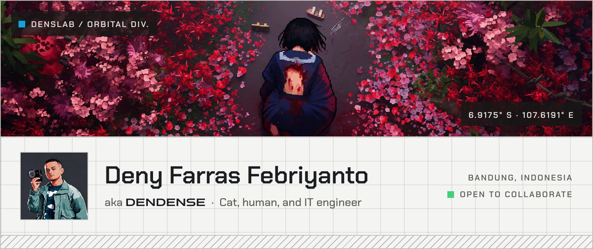
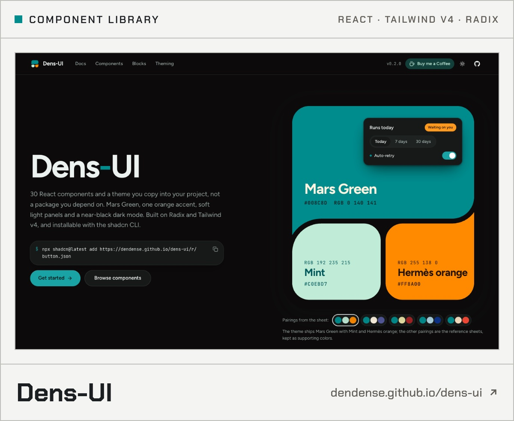
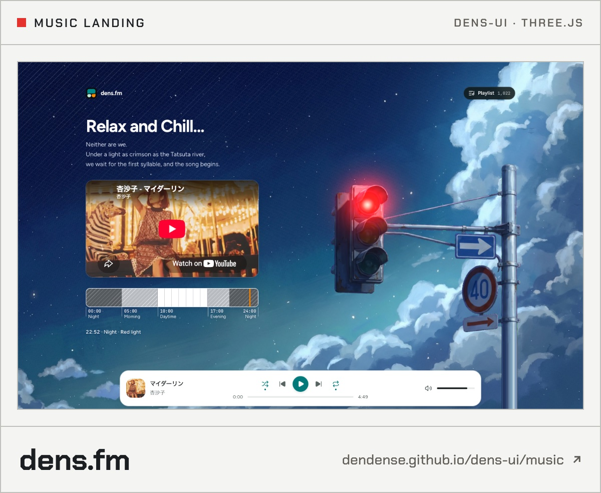
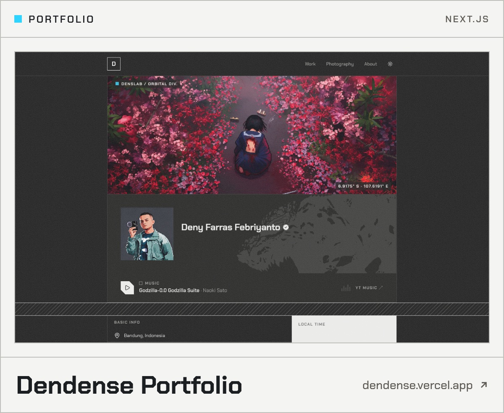
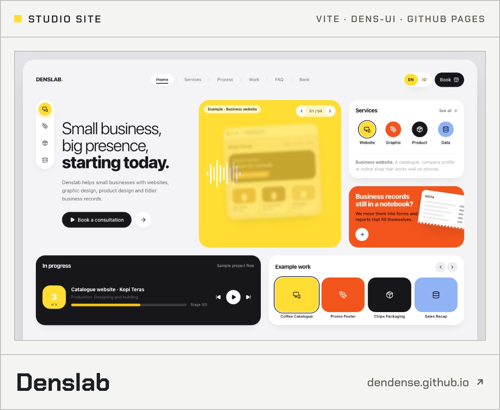
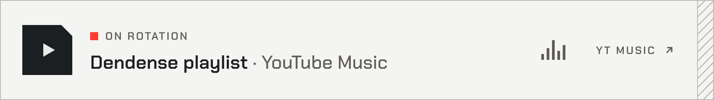

<a href="https://dendense.vercel.app">
  <picture>
    <source media="(prefers-color-scheme: dark)" srcset="assets/banner-dark.jpg">
    
  </picture>
</a>

  <a href="https://dendense.vercel.app"><b>Portfolio</b></a> &nbsp;·&nbsp;
  <a href="https://denslab.vercel.app">Gallery</a> &nbsp;·&nbsp;
  <a href="https://www.instagram.com/deny_desu/">Instagram</a> &nbsp;·&nbsp;
  <a href="https://fb.com/deniyanto123">Facebook</a> &nbsp;·&nbsp;
  <a href="mailto:denyfarras@gmail.com">Email</a>

I'm a cat, a human, and also an IT engineer. I build things under the name **Denslab**: a React component library, a music landing, a studio site for small businesses, and the portfolio that holds my photography. Right now I'm working on [Denslab FG Commission](https://github.com/dendense/denslab-fgcommission) and learning AI agents and vibe coding.

## Running now

  <a href="https://dendense.github.io/dens-ui"><picture>
    <source media="(prefers-color-scheme: dark)" srcset="assets/card-ui-dark.jpg">
    
  </picture></a>
  <a href="https://dendense.github.io/dens-ui/music.html"><picture>
    <source media="(prefers-color-scheme: dark)" srcset="assets/card-fm-dark.jpg">
    
  </picture></a>

  <a href="https://dendense.vercel.app"><picture>
    <source media="(prefers-color-scheme: dark)" srcset="assets/card-porto-dark.jpg">
    
  </picture></a>
  <a href="https://dendense.github.io"><picture>
    <source media="(prefers-color-scheme: dark)" srcset="assets/card-lab-dark.jpg">
    
  </picture></a>

- **[Dens-UI](https://dendense.github.io/dens-ui)** · 30 copy-paste React + Tailwind v4 components in Mars Green, installable with the shadcn CLI. [Source](https://github.com/dendense/dens-ui)
- **[dens.fm](https://dendense.github.io/dens-ui/music.html)** · a relax-and-chill music landing built with Dens-UI over a three.js sky. [Source](https://github.com/dendense/dens-ui/tree/main/src/music)
- **[Dendense Portfolio](https://dendense.vercel.app)** · my work, photography and the person behind them.
- **[Denslab](https://dendense.github.io)** · websites, graphic design, product design and data for small businesses. [Source](https://github.com/dendense/dendense.github.io)
- Also: **[Denslab Gallery](https://denslab.vercel.app)**, AI-generated work and photographs, and **[FG Commission](https://github.com/dendense/denslab-fgcommission)**, booking for photographers and slots.

## About

- IAF XLVII · PDE XXXVII
- Looking to collaborate with other developers
- 2026 goal: stay alive
- Fun fact: I love music, photography and Japanese things

<a href="https://www.youtube.com/playlist?list=PLV6oQHOzWjQZTG_vwJ2kwAEY8OPDbU8C8">
  <picture>
    <source media="(prefers-color-scheme: dark)" srcset="assets/playlist-dark.png">
    
  </picture>
</a>

## Stack

<a href="https://skillicons.dev">
  <picture>
    <source media="(prefers-color-scheme: dark)" srcset="https://skillicons.dev/icons?i=react%2Cnextjs%2Cts%2Ctailwind%2Cvite%2Cthreejs%2Csupabase%2Cpostgres%2Cmysql%2Csass%2Cnodejs%2Cpython&theme=dark">
    
  </picture>
</a>

## Gear

| Kit | Model |
| --- | --- |
| Laptop | MacBook Air M2 |
| Phone | Xiaomi 7 |
| Digital | Sony A6700 + Zeiss 24mm F1.8 |
| Film | Pentax Spotmatic II + SMC Takumar 55mm |
